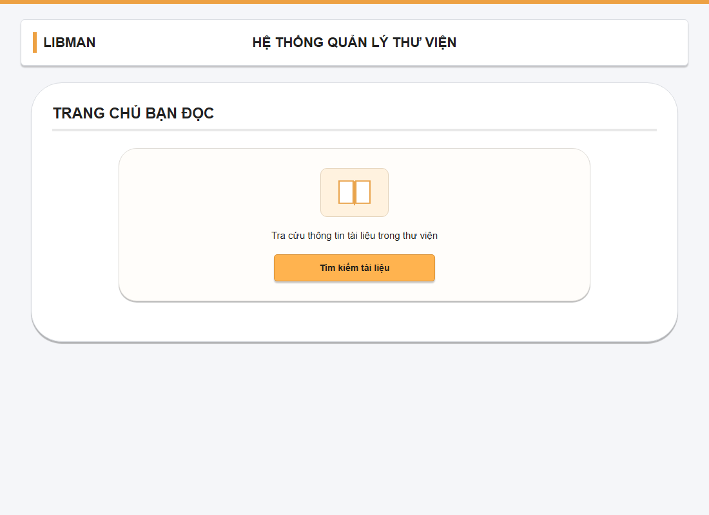
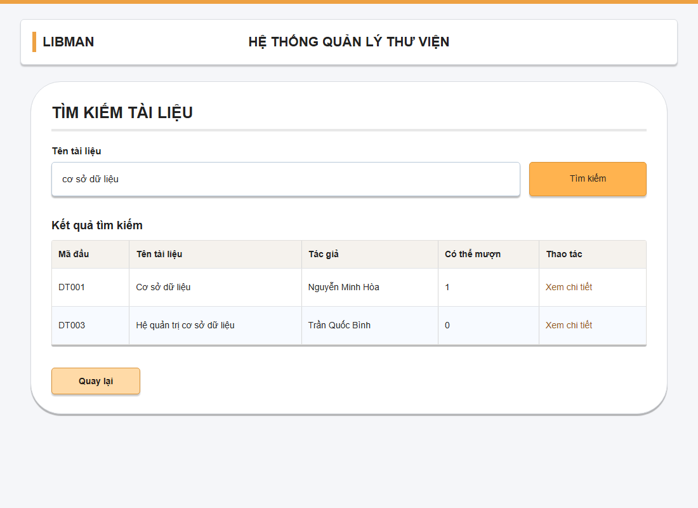
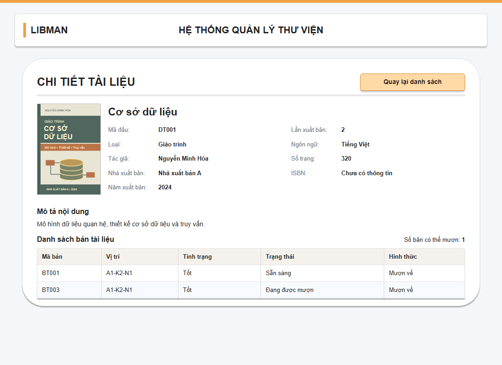

# Library-PTTK — Module tìm tài liệu

Bài thực hành môn **Phân tích thiết kế hệ thống thông tin**: module tìm tài liệu
trong hệ thống quản lý thư viện **LIBMAN**, xây dựng bằng **Java Servlet + JSP**
theo mô hình MVC. Giao diện trắng–cam, thanh LIBMAN, khung bo tròn và bảng kết quả
được dựng theo ảnh yêu cầu. Bìa sách là hình minh họa SVG đi kèm project.

## Chạy nhanh trên Windows

Yêu cầu: **JDK 17 trở lên**, **Maven 3.9 trở lên**. Máy hiện tại có sẵn Java 21 và Maven.

```powershell
cd D:\Library-PTTK
mvn compile exec:java
```

Mở **http://localhost:8080**. Cũng có thể chạy file `run.bat`.
Lần chạy đầu Maven cần Internet để tải thư viện; không cần cài riêng Tomcat hay CSDL.
Dừng ứng dụng bằng `Ctrl+C`.

Nếu cổng 8080 đang được dùng:

```powershell
mvn compile exec:java "-Dport=8081"
```

Khi đó mở http://localhost:8081.

## Thử đúng luồng trong ảnh

1. Trang chủ bạn đọc → nhấn **Tìm kiếm tài liệu**.
2. Nhập **cơ sở dữ liệu** → nhấn **Tìm kiếm** hoặc Enter.
3. Bảng hiển thị `DT001` và `DT003`, số bản có thể mượn lần lượt **1** và **0**.
4. Nhấn **Xem chi tiết** ở `DT001` để xem thông tin sách và hai bản `BT001`, `BT003`.
5. Nhấn **Quay lại danh sách** để trở về kết quả với từ khóa cũ.
6. Nhấn **Quay lại** ở trang tìm kiếm để về trang chủ.

Tìm kiếm theo một phần tên, không phân biệt hoa/thường hoặc dấu tiếng Việt.
Ví dụ `CO SO DU LIEU` vẫn cho cùng kết quả. Từ khóa trống hiển thị tất cả
ba đầu tài liệu. Không có kết quả hoặc mã tài liệu không hợp lệ có thông báo riêng.
Tài liệu hết bản có thể mượn vẫn được xem chi tiết.

## Cấu trúc và cách đọc code

```text
Library-PTTK/
├── pom.xml                              # Thư viện và cấu hình Maven
├── run.bat                              # Chạy nhanh trên Windows
├── docs/phan-tich-thiet-ke.md            # Use case, luồng xử lý, sơ đồ lớp
└── src/
    ├── main/
    │   ├── java/vn/edu/library/
    │   │   ├── Application.java         # Tomcat cục bộ, phục vụ chạy thử
    │   │   ├── model/
    │   │   │   ├── TaiLieu.java          # Đầu tài liệu
    │   │   │   └── BanTaiLieu.java       # Từng bản tài liệu
    │   │   ├── dao/TaiLieuDAO.java       # Dữ liệu mẫu, tìm tên và tìm mã
    │   │   └── servlet/
    │   │       ├── TrangChuServlet.java
    │   │       ├── TimTaiLieuServlet.java
    │   │       └── ChiTietTaiLieuServlet.java
    │   └── webapp/
    │       ├── assets/                  # CSS và bìa sách SVG
    │       └── WEB-INF/
    │           ├── web.xml              # Khai báo Servlet và đường dẫn
    │           └── views/               # JSP và phần header/footer chung
    └── test/java/vn/edu/library/         # Kiểm tra tìm kiếm và luồng HTTP
```

Đọc lần lượt `TaiLieu`/`BanTaiLieu` → `TaiLieuDAO` → `TimTaiLieuServlet`
→ `tim-tai-lieu.jsp`. Servlet lấy tham số, gọi DAO rồi `forward` tới JSP.
JSP dùng EL và JSTL để hiển thị, không chứa code truy vấn hoặc xử lý tìm kiếm.
Mọi JSP nằm trong `WEB-INF` để được truy cập thông qua Servlet.

| Đường dẫn | Servlet | Màn hình |
| --- | --- | --- |
| `/` hoặc `/trang-chu` | `TrangChuServlet` | Trang chủ bạn đọc |
| `/tim-tai-lieu?tenTaiLieu=...` | `TimTaiLieuServlet` | Tìm kiếm và kết quả |
| `/chi-tiet-tai-lieu?ma=DT001&tenTaiLieu=...` | `ChiTietTaiLieuServlet` | Chi tiết và danh sách bản |

## Dữ liệu mẫu

Project dùng danh sách trong bộ nhớ ở `TaiLieuDAO` để code ngắn, dễ hiểu
và có thể chạy ngay. **Chưa kết nối cơ sở dữ liệu**; thông tin tên tác giả,
nhà xuất bản và tài liệu là dữ liệu minh họa phục vụ bài tập.

Để thêm sách, thêm đối tượng `TaiLieu` và các `BanTaiLieu` vào `DANH_SACH`.
Số bản có thể mượn được tính từ các bản có `sanSang = true`.
Khi cần CSDL thật, thay phần dữ liệu và hai phương thức của DAO bằng JDBC;
giữ nguyên Servlet, JSP và luồng màn hình.

## Kiểm tra và đóng gói

```powershell
mvn verify
```

Lệnh này chạy kiểm thử tìm kiếm, gọi HTTP thật qua Tomcat để biên dịch các JSP,
kiểm tra luồng trang, UTF-8, đầu vào được escape và đóng gói
`target/Library-PTTK.war`.

Để triển khai lên Tomcat ngoài: dùng **Tomcat 10.1**, chép WAR vào thư mục `webapps`
và mở `http://localhost:8080/Library-PTTK/`. Đây là project dùng namespace
`jakarta.servlet`; Tomcat 9 dùng `javax.servlet` nên không tương thích trực tiếp.
`Application.java` chỉ phục vụ chạy nhanh; khi chạy WAR, Tomcat đọc `WEB-INF/web.xml`.

Tài liệu tham khảo: [Tomcat 10.1](https://tomcat.apache.org/tomcat-10.1-doc/)
và [JSTL 3.0](https://jakarta.ee/specifications/tags/3.0/).

## Ảnh giao diện

Ảnh chụp từ ứng dụng JSP/Servlet đang chạy:






