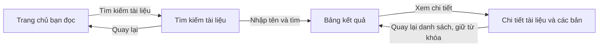
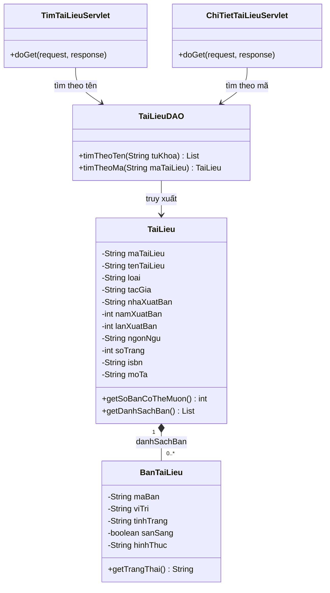
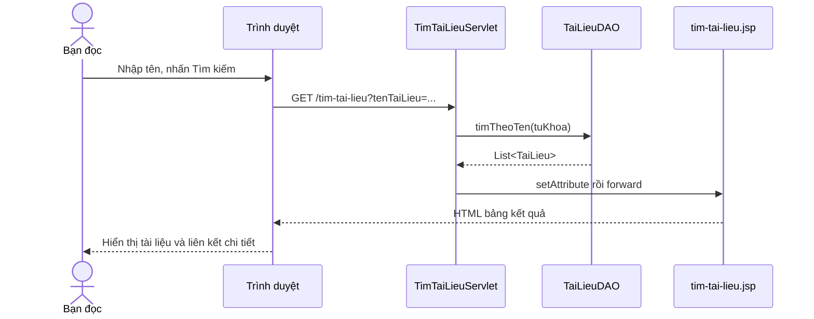

# Phân tích thiết kế module tìm tài liệu

## 1. Phạm vi và tác nhân

**Tác nhân:** Bạn đọc. **Mục tiêu:** tra cứu theo tên và xem thông tin tài liệu,
số lượng có thể mượn và trạng thái từng bản. Không yêu cầu đăng nhập cho việc tra cứu.
Đặt mượn, trả sách, thêm/sửa sách và quản lý tài khoản nằm ngoài module này.

## 2. Đặc tả use case

| Thuộc tính | Nội dung |
| --- | --- |
| Mã | UC-TL-01 |
| Tên | Tìm tài liệu |
| Tác nhân chính | Bạn đọc |
| Tiền điều kiện | Ứng dụng hoạt động, có danh mục tài liệu |
| Kích hoạt | Bạn đọc chọn “Tìm kiếm tài liệu” tại trang chủ |
| Luồng chính | Nhập tên → gửi tìm kiếm → xem kết quả → chọn tài liệu → xem chi tiết |
| Kết quả | Hiển thị thông tin đầu tài liệu và từng bản, không thay đổi dữ liệu |
| Không có kết quả | Thông báo không tìm thấy, cho phép nhập lại |
| Tên trống | Hiển thị tất cả đầu tài liệu |
| Mã không tồn tại/thiếu | Trả HTTP 404, hiển thị liên kết quay lại |
| Hết bản có thể mượn | Vẫn hiện đầu tài liệu, số có thể mượn bằng 0 |
| Quay lại | Giữ nguyên từ khóa khi từ chi tiết về danh sách |

## 3. Luồng màn hình

## 4. Phân chia trách nhiệm theo MVC

| Thành phần | Trách nhiệm |
| --- | --- |
| Model: `TaiLieu`, `BanTaiLieu` | Lưu thông tin và tính số bản có thể mượn |
| DAO: `TaiLieuDAO` | Truy xuất danh sách, tìm theo tên hoặc mã |
| Controller: Servlet | Nhận HTTP request, gọi DAO, đưa kết quả vào request và forward |
| View: JSP | Hiển thị form, bảng, thông tin chi tiết bằng EL/JSTL |

## 5. Sơ đồ lớp chính

## 6. Sơ đồ tuần tự tìm tài liệu

## 7. Gợi ý lưu trữ khi mở rộng JDBC

Hiện tại DAO dùng dữ liệu mẫu trong bộ nhớ. Nếu bài tập yêu cầu CSDL,
có thể ánh xạ thành hai bảng sau:

- `TaiLieu(maTaiLieu PK, tenTaiLieu, loai, tacGia, nhaXuatBan, namXuatBan,
  lanXuatBan, ngonNgu, soTrang, isbn NULL, moTa)`.
- `BanTaiLieu(maBan PK, maTaiLieu FK, viTri, tinhTrang, sanSang, hinhThuc)`.

Mỗi bản thuộc một đầu tài liệu. Tổng số bản sẵn sàng của đầu tài liệu
là số có thể mượn. Khi chuyển sang SQL cần dùng `PreparedStatement` cho tham số
tìm kiếm. JSP/Servlet không cần đổi nếu DAO vẫn trả về cùng các model.
